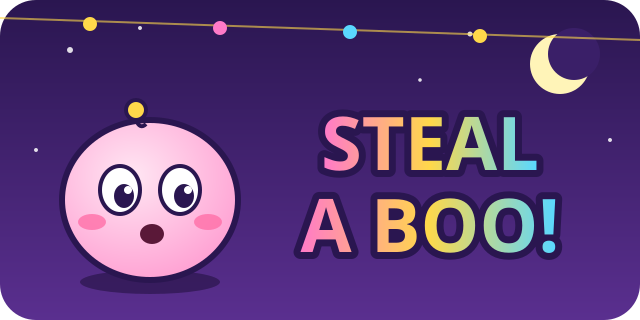
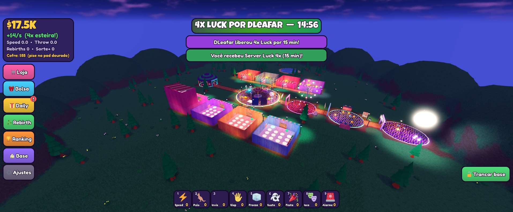
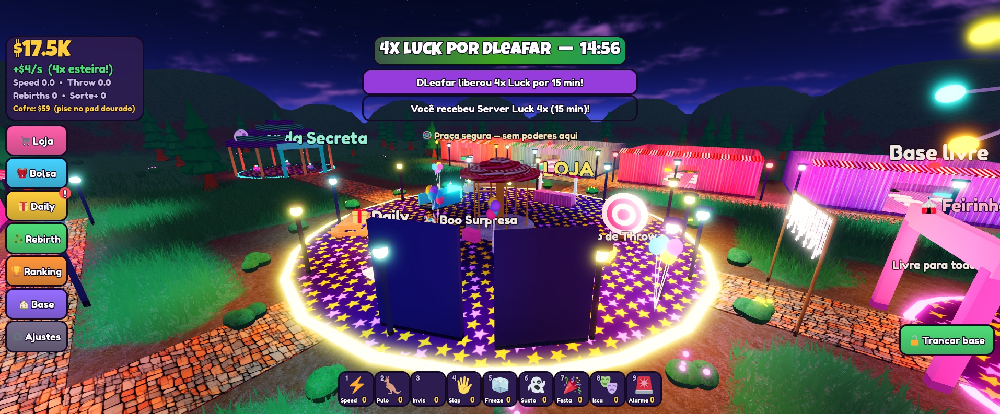
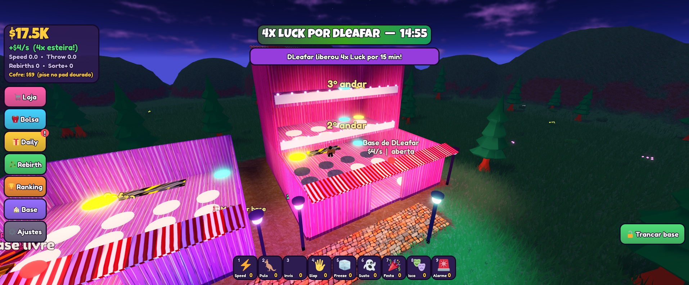
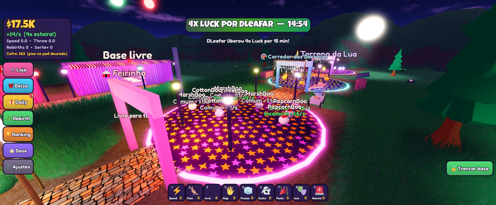
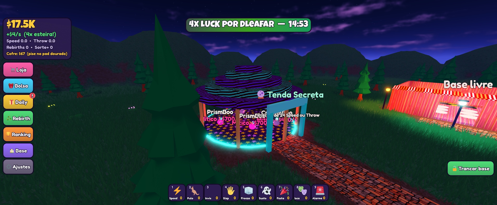

<p align="center">
  
</p>

<p align="center">
  Simulator social de coleta e roubo numa feira noturna.<br>
  Capture Boos, monte sua base, gere Cash por segundo, roube dos amigos e defenda o que é seu.
</p>

<p align="center">
  
  
  
  
</p>

<p align="center">
  
</p>

## Por que este jogo existe

Este projeto é um **experimento pessoal**, feito para se divertir e para testar até onde dá para ir criando um jogo
completo para Roblox com ajuda de IA. Foi desenvolvido de ponta a ponta em **web coding** (programação conduzida por
prompts com assistente de IA), com **supervisão humana**: eu defini a ideia, as regras e o balanceamento, revisei o
código gerado, testei no Studio e corrigi o que não ficou bom.

Não é um produto comercial nem um jogo "sério". É um laboratório leve e divertido para praticar arquitetura
servidor-autoritativa, economia de simulator, monetização e organização de código em Luau.

## O jogo

Você chega num parque colorido. No centro fica a praça neutra com loja, estações de treino, baú diário,
carrossel e rankings. Em volta, oito bases iguais. A leste e a oeste, quatro zonas de captura que pedem
cada vez mais Speed ou Throw Power.

| Praça central | Base com andares |
| --- | --- |
|  |  |
| **Zona de captura** | **Tenda Secreta** |
|  |  |

### Loop principal

1. **Treine** Speed e Throw Power na praça.
2. **Capture** Boos nas zonas. Quanto mais longe, mais raros.
3. **Coloque** os Boos na base. Cada um gera Cash por segundo, que cai no cofre.
4. **Colete** o cofre no pad dourado e **construa andares** (até o 6º).
5. **Evolua** a base no Laboratório e nos pedestais.
6. **Roube** Boos de bases com o portão aberto e corra de volta para a sua.
7. **Defenda**: tranque o portão, use poderes e sustos, ou soque o ladrão e tome o Boo de volta.
8. **Rebirth** para multiplicar a renda para sempre.

### Funcionalidades

- 16 Boos originais em 7 raridades, feitos só com primitivas
- Mapa gerado por código: praça, 8 bases com até 6 andares e 4 zonas temáticas
- Laboratório com 4 trilhas de upgrade e pedestais evolutivos por slot
- Combate ao ladrão: socos, pegada, nocaute e retomada do Boo
- 9 consumíveis, Rebirth, Daily com sequência de 7 dias e ranking global
- Loja com 23 developer products e 5 gamepasses, todos lidos do `Config.luau`
- `ProcessReceipt` único e idempotente por `PurchaseId`
- Save com ProfileStore (session lock, Reconcile, BindToClose)
- Rate limit em todos os remotes e validação de distância, dono, cooldown e estado
- UI responsiva para celular e PC

### Controles

| Tecla | Ação |
| --- | --- |
| WASD e espaço | Andar e pular |
| E (segurar) | Capturar, treinar, colocar, guardar ou roubar um Boo |
| F | Evoluir o pedestal do Boo |
| Q | Socar o ladrão mais próximo |
| 1 a 9 | Poderes e sustos da hotbar |
| L, B | Loja e Bolsa |

## Como rodar

Requisitos: [Rokit](https://github.com/rojo-rbx/rokit) e Roblox Studio com o plugin do Rojo.

```bash
rokit install
wally install
rojo serve
```

No Studio, conecte o plugin do Rojo ao servidor. Para gerar o place:

```bash
rojo build -o build/steal-a-boo.rbxl
```

Para testar o save de verdade no Studio, ative *Enable Studio Access to API Services* em Game Settings > Security.
Sem isso o jogo usa um save em memória.

## Estrutura

```
default.project.json   mapeamento Rojo
assets/                logo, capturas e CREDITS.md
src/
  shared/              Config, Remotes, BooModel, Types e utilidades
  server/              Data, Monetization e Systems (Plot, Boo, Combat, Rebirth, Shop...)
  client/              Controllers de UI, HUD, efeitos e input
  materials/           MaterialVariants
```

O servidor é a autoridade. O cliente só envia pedidos e recebe snapshots leves e efeitos já autorizados.
Tudo que é balance, ID e preço vive em [`src/shared/Config.luau`](src/shared/Config.luau).

## Créditos

Veja [`assets/CREDITS.md`](assets/CREDITS.md). Save por [ProfileStore](https://github.com/MadStudioRoblox/ProfileStore),
de loleris / MAD STUDIO.
